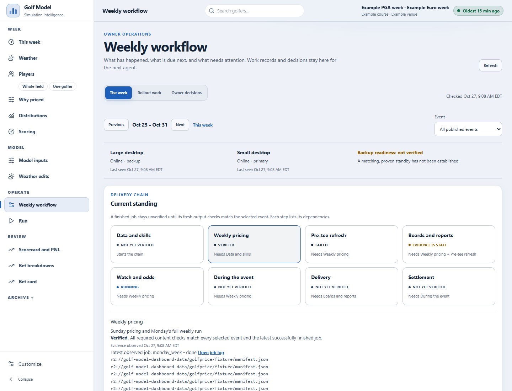
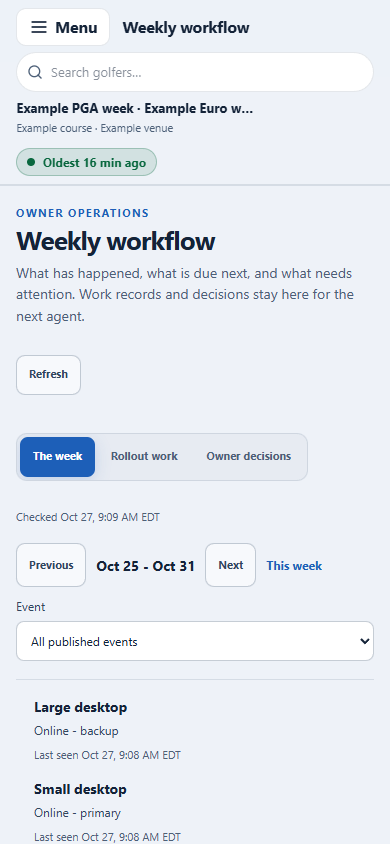

# Weekly workflow verification — October 27, 2026

HIGH risk: private API, authenticated durable writes and dashboard publication. Independent review is required before delivery.

## Actual checks

- `npm test`: 663 tests; 659 passed, 0 failed, 3 skipped, 1 existing TODO. The TODO is the existing This week 150 KB budget target (actual 205.1 KB), not an actual failing test.
- `npx tsc --noEmit --incremental false`: passed.
- Dashboard production build: passed.
- ESLint on changed/new source files: passed. Full repository lint has pre-existing unrelated ExplainViews, MetricTrendPanel, ShapeViews and bet-breakdowns findings.
- Python 3.10 `secret_free_tests.py` with `COEFFS_FROM_CACHE=1` and no production credentials copied into the isolated checkout:

```
pytest: 914 passed, 9 skipped, 0 failed, 0 errors across 61 modules
scripts: 7 programs, 250 passed, 0 failed
not collected: 4 modules
  test_env_setup.py: connectivity script for credentials and external services
  test_finish_probs_real.py: imports round_sim.py, which reads the Google Sheet at import; the program also needs the compiled sims_kernel to compare aggregations
  test_reprice_alert_delivery.py: imports round_sim.py, which reads the Google Sheet at import
  test_round_score_reprice.py: imports round_sim.py, which reads the Google Sheet at import
skipped tests: 1
  test_live_stats_engine_exposes_no_sheet_write_mode: source grep expects `if args.no_sheet_writes:`; live_stats_engine now uses `if args.no_sheet_writes or current_inputs():`
```

The checkout's existing .venv lacked pytest; the successful run used the already installed global Python 3.10 environment. No production environment was changed.

## Browser evidence and limits

These screenshots render the built Worker and application with loopback-only **generated fixtures**, not production data or an owner session. Example events, generated identities and in-memory R2 are explicit in the helper. Desktop 1440×1100 and mobile 390×844 were inspected. Full mobile document width equals viewport width. Browser checks exercised claim, state/note update, release and history readback after reload. Simulated storage failure removed all verified stage and fresh-machine indicators, with an unknown-health banner. A colleague was redirected to `/this-week`, had no owner navigation, and received 403 from the task API. Backend tests cover claim expiry/recovery, competing writes, stale revisions, service identities, owner-only decision provenance and malformed storage.





Production owner sign-in, deployed task write/readback and registered machine-agent authentication remain acceptance gates. No production content-check receipts or automatic failover readiness are claimed by this increment.
## Independent review corrections

The first HIGH review requested changes: self-declared receipt occurrences/missing required outputs, silent polling rebase of drafts, cached health expiry, expired adverse evidence, and missing structured historical state/next-step values. All five received fixes and regression coverage. Receipt tests failed 13 cases against the original rules and pass all 16 after correction. New structured-history tests reproduced the defect against the old built Worker and pass in the 659-passed suite. Actual-browser regressions passed for work drafts, owner-decision drafts, stale cached health and denied colleague access. A fresh second review is required before delivery.

Review round two identified queue/status mispairing after row filtering, malformed latest receipts exposing older success, and cached calendar states failing to expire. The queue is now validated as a whole and paired to statuses by ID; malformed receipt/event-scope documents fail closed without filtering. Calendar observed states also become unverified when response health expires. Full suite after these corrections: 656 passed, 0 failed, 3 existing skips and 1 existing TODO. Actual-browser regressions include expired calendar running/failed indicators. Owner directions received during this work are recorded in golf_ops/docs/ROLLOUT_DECISIONS_20261027.json; seed text preserves that provenance without inventing a Cloudflare owner audit action.

Review round three found future-dated newer evidence being filtered before latest selection. The two requested regressions failed before the fix and pass afterward. Newest scoped job/event receipt is now selected before temporal/tour/occurrence validation; invalid newest evidence cannot uncover an older success. A third regression covers newer wrong-tour/wrong-occurrence receipts. All 19 receipt regressions pass. Calendar browser regression first establishes nonzero Running and Failed cells, then requires both to disappear when health expires.

Final independent HIGH review round four: APPROVE, no reproducible implementation blockers. Reviewer task golf-rollout-b02-code-review4-20261027 independently confirmed newest-evidence selection, 19 receipt regressions, future-week isolation, invalid newer receipts, strengthened browser preconditions and whitespace. Live acceptance gates remain pending.
